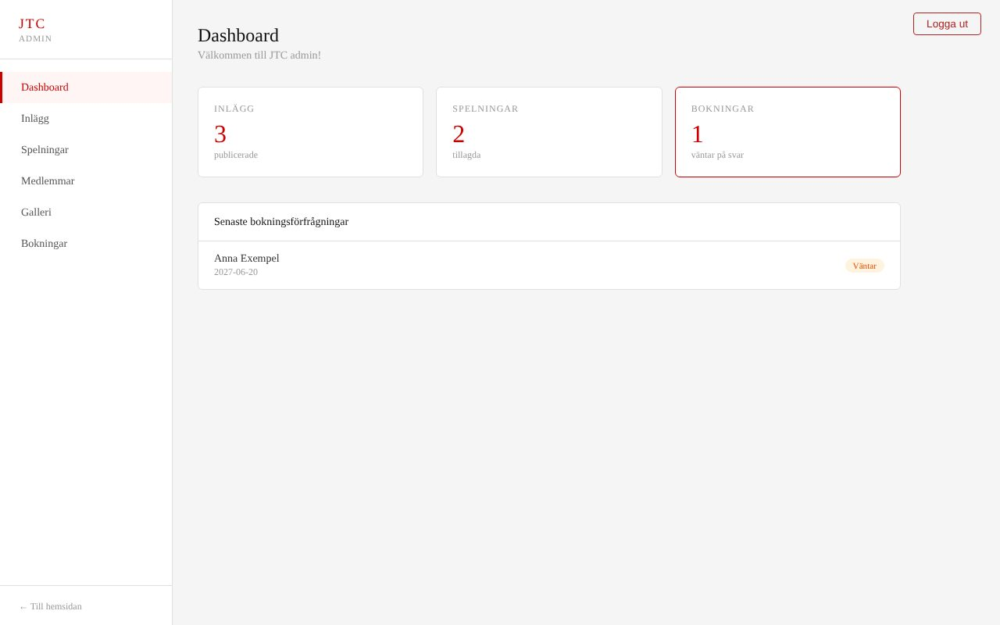

# JTC – webbplats för ett coverband

Fullstack-webbplats för JTC, coverbandet min pappa spelar i. Besökare ser kommande spelningar, nyheter, bandmedlemmar och bilder och kan skicka en bokningsförfrågan. Bandet sköter allt innehåll och svarar på bokningar i en egen adminpanel.

Jag byggde projektet på fritiden för att öva på en komplett stack med ASP.NET Core och React. Sajten har inte publicerats. Innehållet i databasen är exempeldata.




## Funktioner

**Publik sida**
- Startsida med nyheter
- Kommande spelningar med plats, stad och datum
- Bandmedlemmar och bildgalleri
- Bokningsformulär som sparar förfrågan i databasen

**Adminpanel (kräver inloggning)**
- Dashboard med antal inlägg, spelningar och obesvarade bokningar
- Skapa, ändra och ta bort inlägg, spelningar, medlemmar och bilder
- Hantera bokningar: sätt status (väntar, bekräftad, nekad) och skriv ett svar

## Teknik

| Del | Teknik |
| --- | --- |
| Backend | C#, ASP.NET Core (.NET 10), Web API |
| Databas | SQL Server, Entity Framework Core med migreringar |
| Inloggning | JWT (Bearer-token), lösenord hashade med BCrypt |
| Frontend | React 19, React Router, Vite |

## Arkitektur

Backend är uppdelad i lager så att varje del har ett ansvar:

```
Controller  →  Service  →  Repository  →  AppDbContext (EF Core)  →  SQL Server
  HTTP och      regler och     databas-
  behörighet    logik          frågor
```

- **Controllers** tar emot anrop och bestämmer vem som får göra vad. Hela controllern kräver inloggning, och de anrop som ska vara öppna markeras med `[AllowAnonymous]`.
- **Services** innehåller logiken, till exempel att en ny bokning alltid får status "Pending".
- **Repositories** är det enda lagret som pratar med databasen.

I frontend går alla anrop genom `src/services/api.js`. Där sätts backend-adressen, token skickas med automatiskt och användaren loggas ut om token har gått ut.

## API

| Metod | Adress | Öppen | Beskrivning |
| --- | --- | --- | --- |
| POST | `/api/auth/login` | Ja | Logga in, returnerar JWT |
| GET | `/api/posts`, `/api/gig`, `/api/member`, `/api/gallery` | Ja | Hämta publikt innehåll |
| POST | `/api/bookingrequest` | Ja | Skicka bokningsförfrågan |
| GET | `/api/bookingrequest` | Nej | Lista bokningar (innehåller kontaktuppgifter) |
| PATCH | `/api/bookingrequest/{id}/status` | Nej | Svara på en bokning |
| POST, PUT, DELETE | `/api/posts`, `/api/gig`, `/api/member`, `/api/gallery` | Nej | Hantera innehåll |

## Kom igång

Du behöver [.NET 10 SDK](https://dotnet.microsoft.com/download), SQL Server (till exempel SQL Server Express eller LocalDB) och Node.js 22 eller senare.

### 1. Backend

```bash
cd Backend/JTCBackend

# JWT-nyckeln ligger inte i koden. Spara en egen lokalt (minst 32 tecken):
dotnet user-secrets set "Jwt:Key" "byt-till-en-lang-slumpmassig-nyckel-minst-32-tecken"

# Skapa databasen
dotnet tool install --global dotnet-ef   # om du inte redan har det
dotnet ef database update

dotnet run --launch-profile http   # startar API:t på http://localhost:8000
```

Fyll databasen med exempeldata genom att köra `Data/SQL.sql` mot databasen `JTCDatabase`, till exempel i SQL Server Management Studio eller Azure Data Studio.

Connection string finns i `appsettings.json` och utgår från en lokal SQL Server med Windows-inloggning. Ändra den om din databas ligger någon annanstans.

### 2. Frontend

```bash
cd Frontend
cp .env.example .env   # ändra VITE_API_URL om API:t körs på en annan adress
npm install
npm run dev            # öppnar http://localhost:3000
```

### 3. Logga in som admin

Gå till `http://localhost:3000/login` och logga in med användarnamnet `admin` och lösenordet `jtc-admin`. Uppgifterna finns bara i exempeldatan och är till för lokal utveckling.

Skapa ett eget lösenord så här och lägg in hashen i tabellen `Users`:

```bash
dotnet run --project Backend/HashGenerator -- "ditt-lösenord"
```

## Säkerhet

- JWT-nyckeln läses från user-secrets lokalt och från miljövariabeln `Jwt__Key` i produktion. Den finns aldrig i repot.
- Lösenord sparas bara som BCrypt-hashar.
- Alla anrop som ändrar innehåll, och läsning av bokningar, kräver en giltig token.

## Nästa steg

- Ladda upp bilder direkt i adminpanelen i stället för att ange en bildadress
- Validering av indata med DTO:er och felmeddelanden i formulären
- Tester för services och controllers
- Publicera sajten, till exempel på Azure
